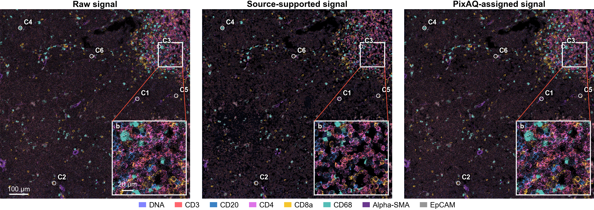
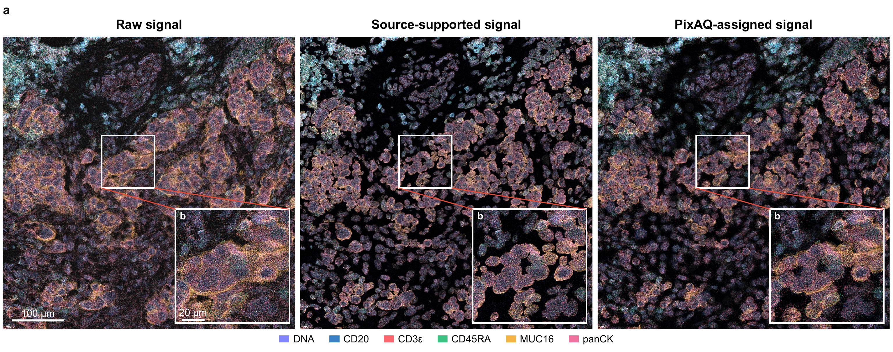

# PixAQ

Pixel Attribution for Quantification.

Code release pending. PixAQ source code will be made publicly available upon journal publication.

## Visual examples

Selected image comparisons from the PixAQ manuscript. The three columns show raw marker signals, signals supported by the original cell masks (Source), and signals assigned by PixAQ using marker-specific supports. Magnified insets show the same locations across the three views.

### Melanoma imaging mass cytometry

Selected melanoma field from manuscript Fig. 4a. The original marker legend, cell labels, scale bars and magnified insets are retained.

### High-resolution imaging mass cytometry

Selected high-resolution IMC field from manuscript Fig. 5a. The original marker legend, scale bars and magnified insets are retained.

### Image data sources

The images are PixAQ manuscript visualizations derived from these published datasets:

- Melanoma IMC: Xu Xiao and colleagues (2022), [Zenodo record 6838169](https://doi.org/10.5281/zenodo.6838169), [CC BY 4.0](https://creativecommons.org/licenses/by/4.0/).
- High-resolution IMC: James Whipman and Alina Bollhagen (2025), [Zenodo record 17077712](https://doi.org/10.5281/zenodo.17077712), [CC BY 4.0](https://creativecommons.org/licenses/by/4.0/).
